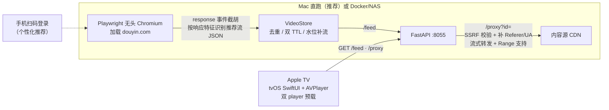

# DYTV

在 Apple TV 上刷短视频推荐流：Mac（或任意 Docker 主机）常驻一个无头浏览器加载网页版内容源，截取推荐流数据，以标准 HTTP 接口供 tvOS 原生客户端播放。遥控器上下滑动切视频，体验对齐原生 App。

> **免责声明**：本项目与字节跳动/抖音无任何关联，仅作为浏览器自动化与 tvOS 客户端的技术实践，供个人学习与局域网内个人使用。不逆向任何签名算法、不绕过 DRM、不分发任何视频内容；所有内容版权归属原作者与平台。使用本项目产生的一切后果（包括账号风控）由使用者自行承担，请遵守平台服务条款。**请勿用于商业用途，请勿将服务端口暴露到公网。**

## 工作原理

不硬刚签名（a_bogus / msToken），让真浏览器自己翻页、自己算参数，只在网络层截取它发出的响应：



核心取舍：**不硬编码推荐流接口路径**（按 `/aweme/` + xhr/fetch + json + 含 `aweme_id` 节点的特征识别），页面改版时大概率继续工作。

## 功能

- 推荐信息流：上/下切视频（上键回看）、下一条提前缓冲、播完自动连播
- 作者页：遥控器右键打开当前作者的作品列表
- 铺满/原比例切换（左键）、暂停（播放键）
- 扫码登录（大屏高清二维码）或导入浏览器 Cookie；登录态持久化，重启不丢
- 码率选档：H.264 ≤1080 最高码率（AVFoundation 不认 hev1 封装的 HEVC），多级回退
- 长期自愈：页面/上下文崩溃自动重建、翻页升级链（按键→滚轮→reload→重建）、验证码页自动暂停、定时 reload 防内存膨胀
- 内置网页播放器（`http://<host>:8055/`），没有 Apple TV 也能在浏览器里验收服务端
- 完整 SSRF 防护（见[安全模型](#安全模型)）

## 快速开始（macOS）

```bash
git clone https://github.com/<you>/dytv.git && cd dytv
./scripts/mac.sh setup    # venv + 依赖 + Chromium（首次约 150MB）+ 生成 .env（含随机管理 token）
./scripts/mac.sh run      # 前台启动，banner 会打印 Apple TV 该填的地址
```

三条命令。要求 Python 3.12（`brew install python@3.12`）。然后：

1. **登录（可选，不登录也能刷默认推荐流）**：终端 banner 里有一行带 token 的登录页地址，浏览器打开 → 手机扫码 → `/status` 显示 `logged_in: true`。`?token=` 正确时会自动换成 HttpOnly Cookie，token 不会留在地址栏
2. **Apple TV**：用 Xcode 打开 `apple-tv/DouyinTV.xcodeproj` 构建（见下节）
3. **开机常驻**：`./scripts/mac.sh service install`（launchd，崩了自动拉起）；`doctor` 随时体检；`logs` 看日志

其他子命令：`setup | run | doctor | service install/uninstall/restart/status | logs | token`。

### Apple TV 客户端

1. `cd apple-tv && cp Config/DYTV.local.xcconfig.example Config/DYTV.local.xcconfig`，填入你的 `DEVELOPMENT_TEAM`（[developer.apple.com](https://developer.apple.com/account) → Membership 页）和 Bundle ID
2. Xcode 打开 `DouyinTV.xcodeproj`，选你的 Apple TV，Run
3. 首次启动进入设置页，填 Mac 的地址（`mac.sh run` 打印的 IP 或 `电脑名.local`）

**免费开发者账号**：签名 7 天过期。`apple-tv/tools/renew.sh` 可自动重签装回（Xcode 图形界面路线，参数写在 `renew.env`），配 launchd 每日运行即可全自动（参考 `scripts/launchd/` 的模板写法）。

## Docker 部署（NAS / Linux）

```bash
cd server
docker compose up -d --build
```

依赖 Playwright 官方镜像（仅 x86_64；ARM NAS 需自备浏览器镜像）。登录态在 `server/user_data/`（volume 挂载）。注意：**Mac 直跑与 Docker 的 user_data 互不通用**（加密方式不同），迁移登录态请走 Cookie 导入。局域网代理（Clash fake-ip 等）场景设 `ALLOW_FAKE_IP=1`。

## 配置项

Mac 直跑写入仓库根 `.env`（`setup` 自动生成，环境变量优先）；Docker 用 compose 的 `environment`。全部项有合理默认，列常用的：

| 变量 | 默认 | 说明 |
|---|---|---|
| `BIND_PORT` | `8055` | 监听端口 |
| `ADMIN_TOKEN` | 空 | 保护 `/login` 全家（空=局域网内不设防；`mac.sh setup` 会自动生成随机值，`token` 子命令可轮换） |
| `USER_DATA_DIR` | `<main.py 同级>/user_data` | 登录态目录（Docker 镜像内固定 `/app/user_data`） |
| `ALLOW_FAKE_IP` | 关 | Clash/Surge fake-ip 模式（DNS 返回 198.18.x.x）时开启；开启后仍经 DoH 二次核验真实 IP 为公网才放行 |
| `MAX_HEIGHT` | `1080` | 码率选档上限（`720` 省带宽） |
| `LOW_WM` / `HIGH_WM` | `15` / `40` | 队列补流水位 |
| `SERVE_TTL` / `INDEX_TTL` | `5400` / `10800` | 未分发条目 / 已分发索引的保留秒数 |
| `BLOCK_MEDIA` | `1` | 拦截浏览器自身加载视频省带宽；翻页异常时设 `0` 排查 |
| `ALLOWED_CDN_SUFFIXES` | 内置列表 | 视频流代理域名白名单（逗号分隔） |
| `DYTV_ACCESS_LOG` | `0` | 开启 uvicorn 访问日志（token 已自动脱敏） |

## 安全模型

设计上假设服务端口会被局域网内不可信设备触达：

- **`/proxy` 只收 id 不收 URL**：目标地址来自服务端截胡时的映射，外部无法指定任意地址
- **SSRF 纵深防御**：仅 http/https；域名点边界白名单（抖音系 CDN 后缀）；禁 IP 字面量与非标端口；DNS 解析结果全量公网校验（拒绝 loopback/私网/保留/组播）；手动跟随 302 **逐跳重复全部校验**
- **fake-ip 场景不降级**：`ALLOW_FAKE_IP=1` 放行的 198.18.x.x 目标必须先经 DoH（IP 直连，不走代理 DNS）查到真实 A/AAAA 记录并确认全量公网，DoH 失败一律拒绝
- **`/login` 系列可设管理 token**：请求头 / query / HttpOnly Cookie 三渠道，`?token=` 一次换 Cookie；`mac.sh setup` 自动生成随机值
- **访问日志脱敏**：token 出现在任何日志行前统一打码

## FAQ

- **Python 版本？** 严格 3.12（`mac.sh` 会自动探测 homebrew/pyenv 路径）。Playwright 版本与 Docker 镜像 tag 严格一致，启动时断言
- **Chromium 下载慢/失败？** `.env` 里设 `PLAYWRIGHT_DOWNLOAD_HOST`（或 `PIP_INDEX_URL`），重新 `setup`
- **提示端口被占用？** 现网服务已在跑。临时换口：`BIND_PORT=8056 ./scripts/mac.sh run`
- **触发验证码？** 服务端会自动暂停 5 分钟（`/status` 的 `captcha` 字段），期间不要硬刷；长期方案是降低使用强度
- **为什么选 H.264 不选 HEVC？** 抖音 HEVC 常为 hev1 封装，AVFoundation 只认 hvc1，播不出画面
- **Mac 和 NAS 双部署？** 可以，但两边 user_data 不通用，登录态走 Cookie 导入迁移；Apple TV 设置页可保存最近 3 个地址快速切换
- **合盖/睡眠后中断？** 常驻场景设置 `pmset -a sleep 0`（或接显示器），`doctor` 会提示当前睡眠设置

## 开发与测试

```bash
cd server && python3.12 -m venv .venv && .venv/bin/pip install -r requirements.txt
.venv/bin/python tests_local.py    # 纯静态验收（mock 掉重依赖），50 个用例
```

提交前自动跑隐私扫描：`scripts/privacy-scan.sh`（已挂 pre-commit hook，检查个人信息泄漏与 bash 3.2 兼容陷阱）。

## License

[MIT](LICENSE)，仅供学习交流。
